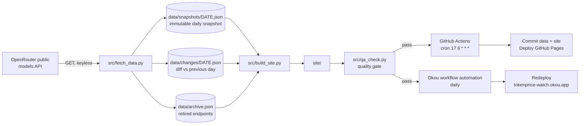

# TokenPrice Watch

**A daily-updated LLM API price tracker.** Every day it re-collects pricing for ~470
inference endpoints, writes an immutable dated snapshot, diffs it against the previous day,
and rebuilds a static site: per-model pages, provider pages, workload rankings, a daily
price-change log, a retired-model archive and an interactive cost calculator.

| | |
|---|---|
| Live site (primary) | https://tokenprice-watch.okou.app |
| Live site (GitHub Pages) | https://singletonye.github.io/tokenprice-watch/ |
| Update cadence | Daily, 06:17 UTC (plus on-demand) |
| Stack | Python 3.12 standard library + static HTML/CSS/JS. No frameworks, no build tools, no database, no API keys |
| Data source | `openrouter.ai/api/v1/models` (public, keyless) |

---

## 1. Why this site can earn money

Monetization is a *property of the audience*, not of the code. This niche was chosen because:

* **Buyer intent is unusually high.** Every visitor is comparing prices before choosing an
  inference provider — the same query intent that advertisers pay **$5–$28 per click** for
  (see [`MONETIZATION.md`](MONETIZATION.md), measured 2026-10-17 via DataForSEO).
* **The data is genuinely daily.** 470 endpoints, 67 providers, real price cuts, new
  snapshots and retirements every day. Content freshness is not manufactured.
* **It compounds.** Daily snapshots accumulate into a price-history dataset nobody can
  copy retroactively, and programmatic pages (per model, per provider, per workload) target
  hundreds of long-tail commercial queries.
* **Three revenue rails, all already wired**: display ads (AdSense), affiliate/referral
  links to inference providers, and direct sponsor slots sold on the comparison tables.

**Honest framing:** the code and its monetization rails are done and running. Revenue is not
guaranteed and not automatic — it requires traffic, which requires distribution work that a
script cannot do for you. `MONETIZATION.md` gives the arithmetic ($50/day ≈ 45,000–60,000
monthly pageviews via sponsor + referral, or 100,000–250,000 via AdSense alone), the
keyword targets with measured volumes, and a 90-day operating plan.

---

## 2. The daily-update guarantee

Two independent mechanisms update the site. Either one alone is sufficient; both run so a
failure in one does not stop the other.



| Mechanism | Trigger | Commits data | Publishes | Independent of |
|---|---|---|---|---|
| GitHub Actions (`.github/workflows/daily.yml`) | cron `17 6 * * *` UTC + manual dispatch | yes (permanent history in git) | GitHub Pages | anything local |
| Okou workflow automation | daily schedule | yes (via `git push`) | `tokenprice-watch.okou.app` | GitHub Actions |

**Failure behaviour is deliberate.** If the upstream API returns fewer than 50 models, the
collector aborts *without overwriting data* and exits non-zero, so a bad upstream response
can never wipe the site or publish a half-empty catalogue. The quality gate then refuses to
publish on structural errors (missing titles, broken internal links, invalid JSON-LD).

**How to verify it is still running** (10 seconds):

```bash
gh run list --repo SingletonYe/tokenprice-watch --limit 5        # last CI runs
gh api repos/SingletonYe/tokenprice-watch/commits --jq '.[0].commit.message'
curl -s https://tokenprice-watch.okou.app/ | grep -o 'Data as of [^<]*'
git log --oneline -- data/changes | head -5                       # daily history
```

---

## 3. Repository layout

```
config/site.json            site name, domain, ad slots, affiliate map, sponsor, newsletter
src/fetch_data.py           collect + normalise + snapshot + diff + archive  (no deps)
src/build_site.py           render 473 static pages, feeds, sitemap, ad slots (no deps)
src/qa_check.py             quality gate: structure, links, uniqueness, JSON-LD, sitemap
assets/style.css            one stylesheet, content-hashed on build
assets/app.js               table sort/filter + cost calculator (progressive enhancement)
data/snapshots/YYYY-MM-DD.json   immutable daily price rows (≈36 KiB/day)
data/changes/YYYY-MM-DD.json     daily diff: added / removed / price moves
data/latest.json            today's full model detail (descriptions, modalities, prices)
data/archive.json           retired endpoints with last-known prices
site/                       build output (git-ignored; Pages deploys it as an artifact)
.github/workflows/daily.yml the daily cron pipeline
MONETIZATION.md             unit economics, keyword targets, 90-day plan, risk register
```

### Generated page inventory

| Path | Count | Purpose / search intent |
|---|---|---|
| `/model/<vendor>/<slug>.html` | 381 | Per-model pricing, volume cost table, variants, alternatives, FAQ |
| `/provider/<vendor>.html` | 67 | Per-provider pricing and "what to know before you commit" |
| `/cheapest/<use-case>.html` | 12 | Cheapest API for coding, agents, long context, vision, reasoning, batch, caching, output, 1M context, free, best value |
| `/changes/<date>.html` | 1/day | Dated price-change log (permanent archive) |
| `/models.html` | 1 | Full sortable/filterable table of every endpoint |
| `/cost-calculator.html` | 1 | Input traffic → monthly bill per model |
| `/retired.html` | 1 | Delisted models and their last observed prices |
| `/about.html /methodology.html /advertise.html /privacy.html /terms.html` | 5 | Trust, E-E-A-T, sponsor sales, ad-network requirements |

Pages are emitted as explicit `.html` files rather than directory indexes, because
directory-style URLs (`/models/`) are only resolved by some static hosts. Flat paths work
everywhere, and canonical tags plus the sitemap are absolute, so the two deployments can
differ in domain without any link ambiguity.

### Two data details worth knowing

* **Router endpoints** (`openrouter/auto`, `openrouter/pareto-code`, `nvidia/switchyard`, …)
  are published with a `-1` price sentinel, meaning "the cost depends on which model gets
  routed to". Negative values are treated as *absent* and the endpoint is flagged dynamic: it
  shows `Varies`, explains itself on its page, and is excluded from every price ranking rather
  than silently distorting a table. The quality gate fails the build if a negative price ever
  reaches `data/`.
* **Variants** (`:batch`, `:free`) share one page with their base model instead of generating
  near-duplicate pages, which keeps the site out of thin-content territory.

---

## 4. Run it locally

Requires Python 3.12. No virtualenv, no pip install, no credentials.

```bash
python3 src/fetch_data.py                 # → data/snapshots/<today>.json + changes + archive
python3 src/build_site.py                 # → site/
python3 src/qa_check.py                   # → PASS/FAIL quality gate
python3 -m http.server 8000 --directory site
```

Useful flags:

```bash
python3 src/fetch_data.py --dry-run                     # fetch and diff, write nothing
python3 src/fetch_data.py --date 2026-10-20             # backfill/test a specific date
python3 src/fetch_data.py --api-url file:///tmp/fake.json   # test with a fixture
python3 src/build_site.py --base-url https://example.com --path-prefix /my-repo --no-rss
```

`--path-prefix` exists because GitHub **project** Pages serve from a subpath
(`/tokenprice-watch/`); canonical and Open Graph URLs stay absolute while every root-relative
link is rewritten once. `--no-rss` exists because some hosts only allow fixed-name or
content-hashed non-HTML files: the feed is therefore also written to
`/.well-known/feed.xml`, where its URL stays stable while its content changes daily.

---

## 5. Turning on the revenue

Everything is pre-wired; each rail activates by filling a field in `config/site.json`.

1. **Display ads.** Apply to AdSense (or Ezoic → Raptive as traffic grows). Paste your
   publisher ID into `adsense.client` and the three unit IDs into `slot_top`,
   `slot_inline`, `slot_sidebar`. Real ad units replace the placeholder boxes; the AdSense
   loader script is injected automatically.
2. **Affiliate / referral.** Join the referral programmes for the providers you want to
   promote, then add `{"openrouter": "https://openrouter.ai/?ref=XXXX"}` to
   `affiliates.map`. Those links automatically become `rel="sponsored nofollow"`, and the
   disclosure is already written into `/about/` and `/privacy/`.
3. **Direct sponsors.** Fill `sponsor.label` + `sponsor.url` and the sponsor bar goes live
   site-wide. `/advertise/` is the sales page (audience, placements, editorial rule).
4. **Newsletter** (retention + a sellable asset). Create a free list, put the form action in
   `newsletter.action`; the daily change log is already structured to become the email body.
5. **Analytics.** `analytics.plausible_domain` or `analytics.cloudflare_beacon` — both
   privacy-friendly, no cookie banner required.

Ad placements are labelled and never affect ranking order; the editorial rule is stated
publicly on `/advertise/`. Programme requirements, payouts and the fastest route to
$50/day are worked through in [`MONETIZATION.md`](MONETIZATION.md).

---

## 6. Operating runbook

| Symptom | Check | Fix |
|---|---|---|
| Prices look stale | `gh run list` for a failed run; check the ticker line on the homepage | Re-run the workflow (`gh workflow run daily.yml`), or run the three scripts locally and push |
| Upstream schema changed | `python3 src/fetch_data.py --dry-run` output | Collector aborts safely; adjust field mapping in `normalize()` |
| A page 404s after a model was retired | `/retired/` should hold the entry | Archive is written by `fetch_data.py`; re-run it |
| Ad slots look like "This slot is available" | `config/site.json` → `adsense.client` empty | Fill it in and rebuild |
| Quality gate fails | `python3 src/qa_check.py` prints each problem | Fix the template; nothing publishes until it passes |
| Site slow | `site/` size (≈7 MB for 473 pages) | Nothing to optimise yet; assets are already hashed and single-file |

**Cost:** $0/month. Static hosting on GitHub Pages is free for public repositories, Okou
hosting is included, the data source is public and keyless, and there is no database.

---

## 7. Data honesty and safety

* Prices are collected from a public catalogue and shown as **USD per 1M tokens**, rounded
  for display. **Blended** price = `0.75 × input + 0.25 × output` and is labelled everywhere.
* Benchmark indices (intelligence / coding / agentic) are **quoted from published metadata**,
  never invented; models without one show a dash.
* The footer, `/methodology/` and `/terms/` all state the limits: at most 24 h staleness,
  list prices only, no contractual advice, no provider affiliation.
* Affiliate links are marked `rel="sponsored"`; paid placements are labelled and cannot
  change a ranking.
* Nothing in this repository fabricates price data. The only synthetic data anywhere is
  inside throwaway local tests of the diff renderer.

---

## 8. Verification performed on the live deployments

Both deployments were rebuilt from this exact code and checked page by page, not just at the
root:

| Check | Result |
|---|---|
| Every URL in the live sitemap fetched (472 pages) on `tokenprice-watch.okou.app` | **472/472 returned HTTP 200, 0 failures** |
| GitHub Pages redeployed by CI from the latest commit | workflow `success`; `/`, `/models.html`, `/cost-calculator.html`, `/cheapest/cheapest-for-coding.html`, `/model/openrouter/auto.html` all 200 |
| Quality gate on both builds | `PASS` — 473 pages, unique titles/descriptions, balanced HTML, no broken internal links, valid JSON-LD, sitemap consistent |
| Price sorting, filtering and search in the browser | 381 rows rendered; filtering `claude` → 19 models; sorting by context → 1M-token models first |
| Cost calculator in the browser | 1.14B tokens/month → cheapest tracked option `$0` (free tier), median `$840`, most expensive `$279,000` |
| Router endpoint rendering | `Varies` instead of a bogus negative price, with an explanation on the page |
| Daily pipeline in CI | collect → build → gate → commit data → deploy, **success** on a real `workflow_dispatch` run |
| Scheduled automation | fired at its scheduled time and queued its run |

The initial live check is what caught the directory-URL problem, the negative router prices
and the retired-model dead links — which is exactly why it runs before any traffic arrives.

---

## 9. Roadmap (already scoped)

1. Publish the daily change log as an email + an X/Reddit thread automatically (the diff is
   already machine-readable — `data/changes/*.json`).
2. Price-alert subscriptions ("email me when Claude drops below $X"), the natural paid tier.
3. A public JSON API + CSV export of the snapshot history — cheap distribution, earns links.
4. Historical price charts per model once ≥30 daily snapshots exist (the sparkline is
   already rendered and switches on by itself).
5. Compare against list prices from other catalogues to catch divergence.

---

MIT licensed. Not affiliated with, endorsed by, or sponsored by any model provider.
